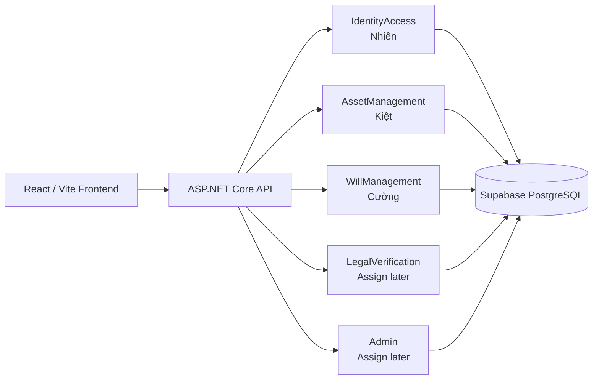
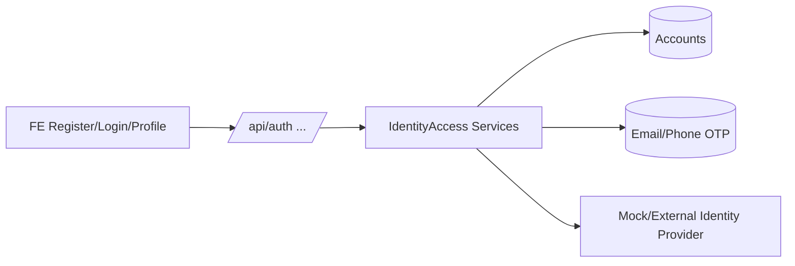
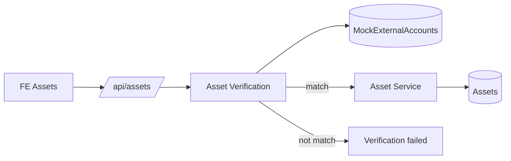
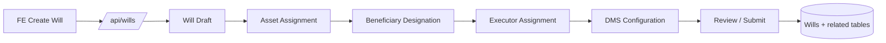

# LegacyVault Backend Package Map

Mục tiêu của file này là chia package trước để 3 Backend tự code độc lập nhưng vẫn nối đúng FE và cùng Supabase.

## 1. Sơ đồ tổng thể



## 2. Phân package cho Backend

```text
backend/SWP301BETASK/
├── Features/
│   ├── IdentityAccess/          # Nhiên
│   │   ├── Controllers/
│   │   ├── DTOs/
│   │   ├── Models/
│   │   ├── Services/
│   │   ├── Repositories/
│   │   └── Contracts/
│   │
│   ├── AssetManagement/        # Kiệt
│   │   ├── Controllers/
│   │   ├── DTOs/
│   │   ├── Models/
│   │   ├── Services/
│   │   ├── Repositories/
│   │   ├── Contracts/
│   │   └── Verification/
│   │
│   ├── WillManagement/         # Cường
│   │   ├── Controllers/
│   │   ├── DTOs/
│   │   ├── Models/
│   │   ├── Services/
│   │   ├── Repositories/
│   │   ├── Contracts/
│   │   ├── Beneficiaries/
│   │   ├── Executor/
│   │   └── Dms/
│   │
│   ├── LegalVerification/      # chưa chốt owner
│   └── Admin/                  # chưa chốt owner
│
├── Data/                       # DbContext hiện tại
├── Migrations/                 # EF Core migrations
└── Shared/                     # code dùng chung
```

## 3. Luồng Nhiên — Identity / Auth



FE contract hiện có trong `frontend/src/api/authApi.js`:

- `POST /auth/register`
- `POST /auth/login`
- `POST /auth/verify-otp`
- `POST /auth/resend-otp`
- `POST /auth/forgot-password`
- `POST /auth/reset-password`

## 4. Luồng Kiệt — Asset



Flow demo mong muốn:

```text
Chọn Provider/Type
→ nhập tài khoản + mật khẩu giả
→ query MockExternalAccounts
→ không match: báo không có tài sản phù hợp
→ match: cho tạo Asset
→ lưu Asset vào database
```

## 5. Luồng Cường — Will / Beneficiary / Executor / DMS



Dependencies:

```text
IdentityAccess provides AccountId
AssetManagement provides AssetId
WillManagement consumes AccountId + AssetId
```

## 6. FE → BE package mapping

| FE file/module | Backend package | Status |
|---|---|---|
| `api/authApi.js` | IdentityAccess | FE contract exists; BE to implement |
| `pages/Profile`, `VerifyIdentity` | IdentityAccess | BE to implement |
| `pages/Assets` + asset functions in `mockVault.js` | AssetManagement | mock now; BE to implement |
| `CreateWill`, `MyWills`, `WillDetails`, Owner flows | WillManagement | mock now; BE to implement |
| `api/executorApi.js` | WillManagement / Executor | FE contract exists; BE to implement |
| `api/verifierApi.js` | LegalVerification | placeholder package |
| `api/adminApi.js` | Admin | placeholder package |
| `/api/accounts` | existing legacy AccountsController | already available as test API |

## 7. Quy tắc khi code

- Không copy logic FE mock vào Controller; FE mock chỉ là contract/tham khảo flow.
- Controller nhận request và trả response; nghiệp vụ để trong Service.
- Model/DTO của feature nào đặt trong feature đó.
- `Data/LegacyVaultDbContext.cs` và `Migrations/` dùng chung.
- Mỗi feature branch chỉ sửa package của mình nếu có thể.
- Migration lên Supabase shared nên do một người review/apply sau merge.
